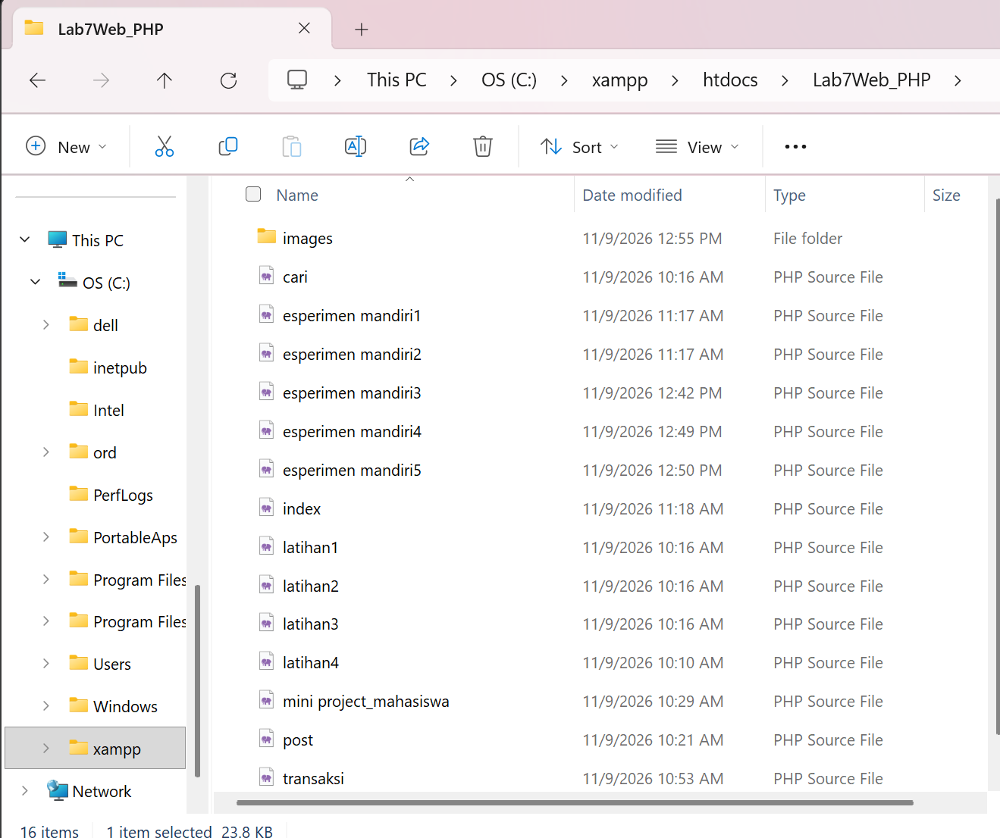
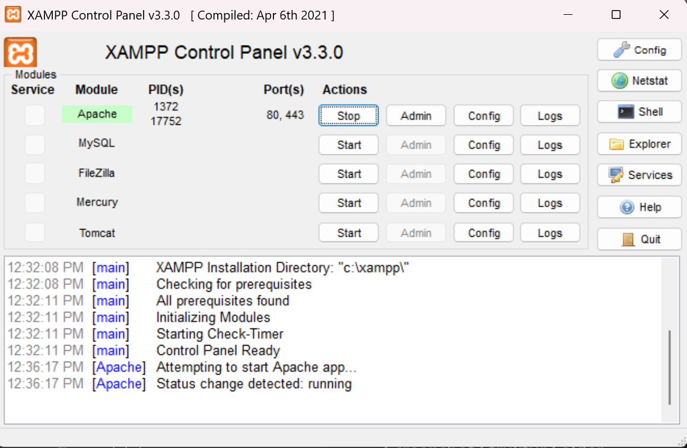

# LAPORAN PRAKTIKUM 7

## PHP SERVER-SIDE DAN PENGOLAHAN FORM

### Identitas Mahasiswa

-   **Nama:** UGI INSAN MULYAWAN
-   **NIM:** 312510268
-   **Program Studi:** Teknik Informatika
-   **Mata Kuliah:** Pemrograman Web
-   **Praktikum:** Praktikum 7 --- PHP Server-Side

------------------------------------------------------------------------

## Pengertian PHP Server-Side

PHP (*Hypertext Preprocessor*) adalah bahasa pemrograman yang dijalankan
di sisi server. PHP digunakan untuk memproses data, menjalankan logika
program, mengolah formulir, serta menghasilkan halaman HTML yang
dikirimkan kepada browser.

Berbeda dengan HTML yang digunakan untuk membangun struktur halaman dan
JavaScript yang dapat berjalan di browser, kode PHP diproses oleh server
web. Oleh karena itu, file PHP perlu dijalankan melalui server lokal
seperti Apache pada XAMPP agar hasilnya dapat ditampilkan di browser.

Pada praktikum ini, materi yang dipelajari meliputi dasar PHP,
penggunaan variabel dan tipe data, operator, percabangan, perulangan,
array, function, pengiriman data menggunakan GET dan POST, pengolahan
transaksi sederhana, validasi data di sisi server, serta pembuatan Mini
Project Form Data Mahasiswa.

## Tujuan Praktikum

1.  Memahami pengertian PHP dan cara kerja pemrosesan server-side.
2.  Menjalankan file PHP menggunakan server lokal.
3.  Menggunakan variabel, tipe data, operator, percabangan, dan
    perulangan dalam PHP.
4.  Mengolah data menggunakan array dan function.
5.  Memahami perbedaan metode GET dan POST.
6.  Membuat dan memproses formulir menggunakan PHP.
7.  Melakukan validasi data pada sisi server.
8.  Menggunakan `htmlspecialchars()` untuk menampilkan data dengan lebih
    aman.
9.  Membuat Mini Project Form Data Mahasiswa.
10. Menerapkan materi PHP melalui eksperimen mandiri.

## Struktur File

Struktur folder praktikum yang digunakan adalah sebagai berikut.

``` text
Lab7Web_PHP/
│
├── images/
│
├── cari.php
├── eksperimen mandiri1.php
├── eksperimen mandiri2.php
├── eksperimen mandiri3.php
├── eksperimen mandiri4.php
├── eksperimen mandiri5.php
│
├── index.php
├── latihan1.php
├── latihan2.php
├── latihan3.php
├── latihan4.php
│
├── mini project_mahasiswa.php
├── post.php
└── transaksi.php
```

Keterangan:

Folder images/ digunakan untuk menyimpan gambar atau screenshot 
hasil praktikum sebagai dokumentasi setiap latihan dan eksperimen.

File index.php merupakan halaman utama proyek yang digunakan sebagai 
titik awal untuk menjalankan atau mengakses program praktikum.

File latihan1.php digunakan untuk mempraktikkan cara menjalankan kode PHP
melalui web server lokal. File latihan2.php digunakan untuk mempelajari
penggunaan variabel, operator, dan percabangan dalam PHP. File latihan3.php
berisi penerapan perulangan dan array untuk menyimpan serta menampilkan
beberapa data. Sementara itu, file latihan4.php digunakan untuk mempraktikkan
pembuatan function agar kode program lebih terstruktur dan dapat digunakan kembali.

File cari.php digunakan untuk mempraktikkan pemrosesan form menggunakan 
metode GET, yaitu mengirimkan kata kunci melalui parameter URL. File post.php
digunakan untuk memproses data dari form menggunakan metode POST, seperti
menerima nama dan program studi mahasiswa. Selanjutnya, file transaksi.php
digunakan untuk melakukan pengolahan data transaksi sederhana dengan 
menerima nama barang, harga, dan jumlah, kemudian menghitung subtotal secara otomatis.

File mini project_mahasiswa.php merupakan aplikasi sederhana yang dibuat untuk
menerima dan menampilkan data mahasiswa melalui formulir. Data yang 
dimasukkan meliputi nama, NIM, program studi, semester, dan email. Program ini
juga menerapkan validasi data pada sisi server sebelum informasi ditampilkan.

File eksperimen mandiri1.php digunakan untuk melakukan perhitungan nilai 
rata-rata dari tiga komponen nilai. 

File eksperimen mandiri2.php digunakan untuk membuat fitur pencarian nama dari 
array menggunakan metode GET. 

File eksperimen mandiri3.php berisi pembuatan function untuk mengubah format 
angka menjadi mata uang Rupiah. 

File eksperimen mandiri4.php digunakan untuk menerapkan validasi NIM agar hanya 
berisi angka dan memiliki panjang sesuai ketentuan. 

file eksperimen mandiri5.php digunakan untuk menambahkan tombol reset pada form 
serta memahami perbedaannya dengan proses pengiriman ulang data ke server.


## Persiapan Praktikum

### 1. Membuat Folder Praktikum

**Pembahasan:**

Langkah pertama adalah membuat folder `Lab7Web_PHP` di dalam direktori
`htdocs` pada instalasi XAMPP. Folder ini menjadi tempat penyimpanan
seluruh file PHP dan dokumentasi praktikum.

Lokasi folder yang digunakan adalah `C:\xampp\htdocs\Lab7Web_PHP`.
Penyimpanan di dalam `htdocs` diperlukan agar file PHP dapat diakses
melalui server Apache menggunakan alamat localhost.

### Screenshot Struktur Folder



**Keterangan:**

Screenshot menunjukkan folder `Lab7Web_PHP` yang berisi file PHP untuk
praktikum, README, serta folder dokumentasi gambar.

### 2. Menjalankan Server Lokal

**Pembahasan:**

Sebelum menjalankan program, aplikasi XAMPP dibuka terlebih dahulu.
Modul Apache dijalankan dengan menekan tombol Start. Apache berfungsi
sebagai web server yang menerima permintaan browser dan memproses file
PHP.

Setelah Apache aktif, folder praktikum dapat dibuka melalui browser
menggunakan alamat:

``` text
http://localhost/Lab7Web_PHP/
```

### Screenshot XAMPP dan Browser




**Keterangan:**

Apache yang aktif memungkinkan file PHP diproses oleh server lokal.
Halaman utama praktikum dapat dibuka melalui satu alamat localhost,
kemudian setiap menu digunakan untuk membuka halaman latihan yang
diperlukan.

### 3. Membuat Halaman Utama

**Pembahasan:**

File `index.php` digunakan sebagai halaman utama praktikum. Halaman ini
menampilkan daftar menu yang mengarah ke file PHP lainnya, seperti
pengolahan nilai, array, function, form GET, form POST, transaksi, dan
data mahasiswa.

Dengan adanya halaman utama, seluruh bagian praktikum dapat diakses dari
satu URL tanpa harus mengetik alamat setiap file secara manual. Setiap
menu tetap membuka file PHP masing-masing sehingga kode tiap materi
tersusun dengan terpisah.

### Screenshot Codingan


### Hasil Browser


**Keterangan:**

Hasil browser memperlihatkan menu praktikum yang dapat dipilih. Ketika
salah satu menu diklik, browser membuka halaman PHP sesuai menu
tersebut.

------------------------------------------------------------------------

# LANGKAH-LANGKAH PRAKTIKUM

## 1. Dasar PHP dan Variabel

**Pembahasan:**

Pada bagian dasar PHP, program digunakan untuk mengenal penulisan kode
PHP, penggunaan variabel, dan menampilkan hasil ke halaman browser. Kode
PHP diawali dengan tag `<?php` dan dapat menampilkan keluaran
menggunakan `echo`.

Variabel dalam PHP diawali dengan tanda `$`. Variabel digunakan untuk
menyimpan data yang nantinya dapat diproses atau ditampilkan. PHP juga
memiliki beberapa tipe data, seperti string, integer, float, dan
boolean.

### Screenshot Codingan


### Hasil Browser


**Keterangan:**

Hasil browser menunjukkan keluaran dari kode PHP yang telah dijalankan.
Variabel yang dibuat dapat digunakan untuk menyimpan nilai dan
menampilkan informasi menggunakan `echo`.

## 2. Operator dan Pengolahan Nilai

**Pembahasan:**

Pada bagian ini, PHP digunakan untuk melakukan operasi aritmetika dan
mengolah nilai. Operator aritmetika seperti penjumlahan, pengurangan,
perkalian, dan pembagian dapat digunakan untuk menghitung data numerik.

Pengolahan nilai dapat dilakukan dengan menjumlahkan beberapa komponen
nilai, kemudian menghitung hasil akhirnya berdasarkan bobot yang telah
ditentukan. Hasil perhitungan dapat ditampilkan kembali ke halaman
browser.

### Screenshot Codingan


### Hasil Browser


**Keterangan:**

Hasil browser memperlihatkan nilai yang telah diproses oleh PHP.
Perhitungan dilakukan berdasarkan data dan operasi yang dituliskan dalam
program.

## 3. Percabangan dan Perulangan

**Pembahasan:**

Percabangan digunakan untuk menjalankan perintah berdasarkan kondisi
tertentu. Dalam PHP, percabangan dapat menggunakan `if`, `else`, dan
`elseif`. Struktur ini dapat digunakan untuk menentukan hasil atau
kategori berdasarkan nilai yang diperoleh.

Perulangan digunakan untuk menjalankan perintah secara berulang. PHP
menyediakan beberapa bentuk perulangan, seperti `for`, `while`, dan
`foreach`. Perulangan membantu memproses data tanpa harus menuliskan
perintah yang sama berkali-kali.

### Screenshot Codingan


### Hasil Browser


**Keterangan:**

Hasil browser menunjukkan keluaran program berdasarkan kondisi dan
proses perulangan yang dibuat. Percabangan menentukan perintah yang
dijalankan, sedangkan perulangan membantu menampilkan atau memproses
data secara berulang.

## 4. Array dan Function

**Pembahasan:**

Array merupakan struktur data yang digunakan untuk menyimpan beberapa
nilai dalam satu variabel. Setiap data di dalam array dapat diakses
menggunakan indeks atau kunci tertentu. PHP menyediakan perulangan
`foreach` untuk membaca setiap elemen array.

Function atau fungsi merupakan kumpulan perintah yang dibuat untuk
menjalankan tugas tertentu. Fungsi dapat menerima parameter dan
mengembalikan nilai menggunakan `return`. Penggunaan fungsi membantu
membuat kode lebih terstruktur dan dapat digunakan kembali.

### Screenshot Codingan


### Hasil Browser


**Keterangan:**

Hasil browser menampilkan data yang disimpan di dalam array dan hasil
pemanggilan fungsi. Data dapat diproses melalui perulangan, sedangkan
fungsi membantu menjalankan proses tertentu secara terstruktur.

## 5. Latihan Form GET

**Pembahasan:**

Pada latihan ini, formulir dibuat menggunakan metode `GET`. Data yang
dikirim melalui GET akan ditampilkan pada bagian query URL browser. PHP
menerima data tersebut menggunakan variabel superglobal `$_GET`.

Metode GET sesuai digunakan untuk data pencarian atau permintaan yang
tidak bersifat rahasia. Pada contoh pencarian, pengguna memasukkan kata
kunci, kemudian PHP membaca nilai tersebut dan menampilkan hasil
pencarian.

### Screenshot Codingan


### Hasil Browser


**Keterangan:**

Setelah formulir dikirim, kata kunci terlihat pada URL dan dapat dibaca
oleh PHP melalui `$_GET`. Hasil pencarian kemudian ditampilkan pada
halaman browser.

## 6. Latihan Form POST

**Pembahasan:**

Pada latihan ini, formulir menggunakan metode `POST` untuk mengirim data
ke server. Berbeda dengan GET, data POST tidak ditampilkan sebagai query
pada URL. PHP menerima data tersebut menggunakan variabel superglobal
`$_POST`.

Metode POST biasa digunakan untuk mengirim data formulir, seperti nama
atau informasi lainnya. Data yang diterima dapat diperiksa dan diproses
oleh PHP sebelum hasilnya ditampilkan kepada pengguna.

### Screenshot Codingan


### Hasil Browser


**Keterangan:**

Hasil browser menunjukkan data yang dikirim melalui formulir POST dan
diproses oleh PHP. Data diterima melalui `$_POST` tanpa menampilkan
nilai input sebagai query pada URL.

## 7. Pengolahan Data Transaksi Sederhana

**Pembahasan:**

Pada latihan ini, PHP digunakan untuk mengolah data transaksi sederhana.
Formulir berisi informasi barang, harga, dan jumlah pembelian. Setelah
data dikirim, program menghitung subtotal berdasarkan perkalian harga
dengan jumlah barang.

Selain melakukan perhitungan, program juga menerapkan validasi di sisi
server. Data diperiksa agar kolom yang wajib diisi tidak kosong dan
nilai harga serta jumlah sesuai dengan ketentuan. Jika data tidak
sesuai, program menampilkan pesan kesalahan. Jika data benar, hasil
transaksi ditampilkan.

### Screenshot Codingan


### Hasil Browser


**Keterangan:**

Hasil browser menampilkan informasi transaksi dan subtotal yang dihitung
oleh PHP. Pengujian dilakukan dengan memasukkan data barang, harga, dan
jumlah, kemudian memeriksa hasil perhitungan serta respons validasi.

------------------------------------------------------------------------

# MINI PROJECT --- FORM DATA MAHASISWA

## 8. Membuat Form Data Mahasiswa

**Pembahasan:**

Mini Project pada praktikum ini adalah membuat formulir data mahasiswa.
Formulir menyediakan kolom nama, NIM, program studi, semester, dan
email. Data dikirim menggunakan metode POST agar dapat diproses oleh PHP
di sisi server.

Program melakukan validasi terhadap data yang diterima. Kolom wajib
harus diisi, semester harus berupa bilangan bulat dalam rentang 1 sampai
14, dan email harus memiliki format yang valid. Setelah data lolos
pemeriksaan, informasi mahasiswa ditampilkan pada halaman.

Untuk membantu mencegah masukan pengguna ditafsirkan sebagai kode HTML,
data yang ditampilkan menggunakan `htmlspecialchars()`. Pemrosesan data
juga dapat dipisahkan dari bagian tampilan HTML agar susunan program
lebih mudah dipahami.

### Screenshot Codingan PHP


### Hasil Browser


### Pengujian Validasi Form

**1. Pengujian data valid**

Data yang dimasukkan: - Nama: sesuai identitas mahasiswa. - NIM: diisi
dengan nomor induk mahasiswa. - Program studi: Teknik Informatika. -
Semester: angka dalam rentang 1--14. - Email: menggunakan format email
yang benar.

**Hasil yang diharapkan:** Data diterima dan ditampilkan oleh program.

**2. Pengujian nama kosong**

Data yang dimasukkan: kolom nama tidak diisi, sedangkan kolom lainnya
diisi.

**Hasil yang diharapkan:** Program menampilkan pesan bahwa nama wajib
diisi.

**3. Pengujian semester di luar rentang**

Data yang dimasukkan: semester 15.

**Hasil yang diharapkan:** Program menolak data karena semester harus
berada pada rentang 1--14.

**4. Pengujian format email salah**

Data yang dimasukkan: email dengan format yang tidak sesuai.

**Hasil yang diharapkan:** Program menampilkan pesan bahwa email tidak
valid.

**Keterangan:**

Pengujian dilakukan untuk memastikan bahwa data yang diterima sesuai
dengan ketentuan. Data yang valid dapat ditampilkan, sedangkan data yang
tidak sesuai menghasilkan pesan kesalahan dari proses validasi
server-side.

------------------------------------------------------------------------

# EKSPERIMEN MANDIRI

## 9. Eksperimen Mandiri 1 --- Menghitung Rata-rata Tiga Nilai

**Pembahasan:**

Eksperimen pertama dilakukan dengan membuat perhitungan rata-rata dari
tiga komponen nilai. Program menyimpan nilai pertama, kedua, dan ketiga
ke dalam variabel, kemudian menjumlahkan ketiganya dan membaginya dengan
tiga.

Hasil rata-rata ditampilkan pada halaman menggunakan PHP. Eksperimen ini
membantu memahami penggunaan variabel dan operator aritmetika dalam
pengolahan data.

### Screenshot Codingan


### Hasil Browser


**Keterangan:**

Hasil browser menampilkan ketiga nilai dan hasil rata-ratanya.
Perhitungan dilakukan oleh PHP berdasarkan nilai yang disimpan dalam
variabel.

## 10. Eksperimen Mandiri 2 --- Pencarian Nama dari Array Menggunakan GET

**Pembahasan:**

Eksperimen kedua mengubah contoh GET menjadi fitur pencarian nama dari
sebuah array sederhana. Program menyimpan beberapa nama di dalam array,
kemudian menerima kata kunci pencarian melalui `$_GET`.

PHP melakukan pemeriksaan terhadap setiap nama menggunakan perulangan.
Fungsi `stripos()` digunakan agar pencarian dapat menemukan teks tanpa
membedakan huruf besar dan kecil. Jika nama yang sesuai ditemukan,
program menampilkan hasilnya. Jika tidak ada nama yang cocok, program
menampilkan pesan bahwa nama tidak ditemukan.

### Screenshot Codingan


### Hasil Browser


**Keterangan:**

Hasil browser memperlihatkan nama yang cocok dengan kata kunci
pencarian. Pengujian juga dilakukan menggunakan kata kunci yang tidak
tersedia di dalam array untuk melihat pesan ketika data tidak ditemukan.

## 11. Eksperimen Mandiri 3 --- Membuat Function Format Rupiah

**Pembahasan:**

Eksperimen ketiga membuat fungsi untuk mengubah angka menjadi format
mata uang Rupiah. Fungsi menerima angka melalui parameter, kemudian
menggunakan `number_format()` untuk menambahkan pemisah ribuan dan
menghasilkan tampilan angka yang lebih mudah dibaca.

Fungsi dapat dipanggil kembali untuk memformat beberapa nilai tanpa
harus menuliskan proses format secara berulang.

### Screenshot Codingan


### Hasil Browser


**Keterangan:**

Hasil browser menampilkan beberapa angka dalam format Rupiah. Eksperimen
ini menunjukkan bahwa function dapat digunakan kembali untuk menjalankan
proses yang sama dengan nilai berbeda.

## 12. Eksperimen Mandiri 4 --- Validasi NIM

**Pembahasan:**

Eksperimen keempat menambahkan pemeriksaan NIM agar hanya berisi angka
dan memiliki panjang sesuai ketentuan yang dipilih. Pada contoh program,
NIM diperiksa menggunakan `preg_match()` dengan pola yang membatasi
masukan menjadi sepuluh digit angka.

Jika NIM terdiri dari sepuluh angka, program menampilkan pesan bahwa NIM
valid. Jika terdapat huruf, simbol, atau jumlah digit tidak sesuai,
program menampilkan pesan bahwa NIM tidak valid.

### Screenshot Codingan


### Hasil Browser


**Keterangan:**

Pengujian dilakukan dengan memasukkan NIM yang terdiri dari sepuluh
angka dan masukan yang tidak sesuai. Program hanya menerima masukan yang
memenuhi pola validasi. Ketentuan sepuluh digit merupakan contoh panjang
yang dipilih untuk eksperimen dan dapat disesuaikan dengan ketentuan NIM
yang digunakan.

## 13. Eksperimen Mandiri 5 --- Menambahkan Tombol Reset pada Form POST

**Pembahasan:**

Eksperimen kelima menambahkan tombol reset pada formulir yang
menggunakan metode POST. Tombol reset menggunakan atribut `type="reset"`
untuk mengembalikan kolom formulir ke kondisi awal di browser.

Tombol reset berbeda dengan tombol submit. Reset hanya mengembalikan
isian formulir pada sisi browser dan tidak mengirim data ke server.
Sementara itu, submit mengirim data ke server agar dapat diproses oleh
PHP.

### Screenshot Codingan


### Hasil Browser


**Keterangan:**

Hasil browser menunjukkan bahwa tombol reset dapat mengosongkan kembali
isian formulir. Tombol submit digunakan ketika pengguna ingin
mengirimkan data untuk diproses oleh server.

------------------------------------------------------------------------

# H. PERTANYAAN EVALUASI

## 1. Apa perbedaan pemrosesan client-side dan server-side?

Client-side adalah pemrosesan yang dilakukan pada sisi pengguna melalui
browser. Contohnya adalah JavaScript yang digunakan untuk mengubah
tampilan halaman atau merespons tindakan pengguna.

Server-side adalah pemrosesan yang dilakukan pada server. Contohnya
adalah PHP yang menerima data formulir, melakukan validasi, menghitung
data, dan menghasilkan keluaran yang dikirimkan kembali ke browser.

## 2. Mengapa PHP perlu dijalankan melalui web server?

PHP perlu dijalankan melalui web server karena kode PHP harus diproses
oleh interpreter PHP di sisi server. Jika file PHP hanya dibuka secara
langsung sebagai file lokal, browser tidak menjalankan kode PHP seperti
server. Dengan menggunakan Apache pada XAMPP, file PHP dapat diproses
dan hasilnya ditampilkan sebagai halaman web.

## 3. Apa fungsi tanda `$` pada PHP?

Tanda `$` digunakan sebagai awalan nama variabel dalam PHP. Contohnya,
`$nama = "Alya";` digunakan untuk menyimpan teks Alya ke dalam variabel
bernama `$nama`.

## 4. Apa perbedaan metode GET dan POST?

GET mengirimkan data melalui query pada URL sehingga nilai yang dikirim
dapat terlihat di alamat browser. GET sesuai untuk kebutuhan seperti
pencarian.

POST mengirimkan data melalui bagian body permintaan HTTP sehingga data
tidak ditampilkan sebagai query pada URL. POST umum digunakan untuk
mengirim data formulir yang akan diproses oleh server. Namun, POST
sendiri bukan pengganti enkripsi; data sensitif tetap memerlukan HTTPS.

## 5. Mengapa validasi tetap perlu dilakukan di sisi server?

Validasi server-side diperlukan karena pemeriksaan yang hanya dilakukan
di browser dapat dilewati atau dimanipulasi oleh pengguna. Server perlu
memeriksa kembali data yang diterima agar data yang diproses sesuai
dengan ketentuan program.

## 6. Apa fungsi `htmlspecialchars()`?

`htmlspecialchars()` digunakan untuk mengubah karakter khusus HTML
menjadi bentuk entitas HTML sehingga masukan pengguna ditampilkan
sebagai teks, bukan ditafsirkan sebagai tag atau kode HTML. Fungsi ini
membantu mengurangi risiko XSS ketika menampilkan data yang tidak
tepercaya.

## 7. Apa fungsi function dalam PHP?

Function adalah kumpulan perintah yang dibuat untuk menjalankan tugas
tertentu dan dapat dipanggil kembali. Fungsi dapat menerima parameter
dan mengembalikan nilai menggunakan `return`. Penggunaan function
membuat kode lebih terstruktur, mengurangi pengulangan, dan memudahkan
pemeliharaan program.

------------------------------------------------------------------------

# KESIMPULAN

Berdasarkan Praktikum 7 PHP Server-Side, dapat disimpulkan bahwa PHP
merupakan bahasa pemrograman yang berjalan di sisi server dan digunakan
untuk memproses data sebelum hasilnya dikirimkan ke browser. Agar file
PHP dapat dijalankan, diperlukan web server seperti Apache yang tersedia
pada XAMPP.

Materi praktikum mencakup penggunaan variabel, operator, percabangan,
perulangan, array, function, serta pengolahan formulir menggunakan
metode GET dan POST. PHP juga dapat digunakan untuk menghitung data
transaksi dan melakukan validasi masukan pengguna pada sisi server.

Pada Mini Project, materi diterapkan dalam pembuatan Form Data Mahasiswa
yang memeriksa kolom wajib, rentang semester, dan format email.
Penggunaan `htmlspecialchars()` membantu menampilkan masukan pengguna
sebagai teks dengan lebih aman.

Eksperimen mandiri memperluas pemahaman mengenai perhitungan rata-rata,
pencarian data array, format Rupiah, validasi NIM, dan penggunaan tombol
reset pada formulir POST.

Melalui praktikum ini, mahasiswa dapat memahami dasar pemrograman PHP,
cara menjalankan program melalui server lokal, serta penerapan
pemrosesan dan validasi data pada aplikasi web sederhana.

------------------------------------------------------------------------

# DOKUMENTASI

Screenshot codingan dan hasil browser diletakkan setelah pembahasan
masing-masing latihan, Mini Project, dan eksperimen. Setiap screenshot
hasil browser dilengkapi keterangan yang menjelaskan fungsi kode dan
hasil pengujiannya.

Sebelum README diunggah ke repository GitHub, pastikan seluruh
screenshot sudah disimpan di folder `images` dan nama file pada tautan
gambar di README sesuai dengan nama file yang sebenarnya.

File `README.md` disimpan bersama seluruh file PHP di dalam folder
praktikum `Lab7Web_PHP`. Untuk menjalankan praktikum, aktifkan Apache
pada XAMPP kemudian buka alamat `http://localhost/Lab7Web_PHP` melalui
browser.
